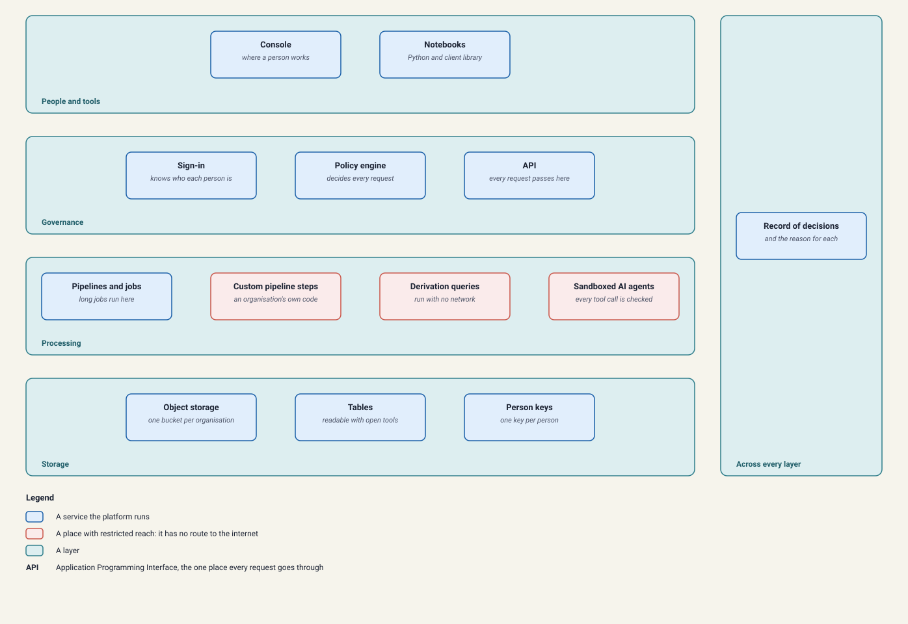

# Munitas: system architecture

What the platform is built from, and how a request moves through it.

Companion reading: [the governance model](design/governance-model.md) for who is accountable for what, and the [walkthroughs](https://albinjacob.github.io/munitas/walkthroughs/feature-walkthrough.html) for these rules in action, screen by screen.

---

## 1. How a request moves through the platform

A person works in the Console and signs in. Every request goes to the API. The API asks the policy engine whether the request is allowed, and records the answer with its reason. If it is allowed, the API hands out a short-lived key for exactly what was approved, and nothing more.

Long jobs, such as a pipeline run, are handled by the workflow engine and the worker. Code that is not the platform's own runs in places with limited reach: sandboxed AI agents on a network with no route to the internet, an organisation's own pipeline steps in containers with no storage and no key, and the queries that make new datasets with no network at all.

---

## 2. The services

| Service | What it does |
| --- | --- |
| Console | Where a person signs in and works: registers data, requests access, approves it, reviews results |
| API | The one place every request goes through. It asks the policy engine, records decisions, and hands out short-lived keys |
| Policy engine (Open Policy Agent) | Answers every access, approval, export and release question, and gives a reason for every allow and every refusal |
| Sign-in (Ory Kratos and Ory Hydra) | Real sign-in for every person. It also lets a notebook act for one person, with a short-lived pass |
| Workflow engine (Temporal) | Keeps long jobs running and resumes them after a crash: pipeline runs, imports, agent runs that wait for approval, and scheduled clean-ups |
| Worker | Runs pipelines and AI agents. Whenever it reads or writes data, it uses a key made for that one task |
| Table worker | Writes large tables in the background |
| Database (PostgreSQL) | Records every dataset version and every decision, including refusals, and keeps the history, so what was allowed on any past date can be answered |
| Object storage | Where the files live, one bucket per organisation. A key opens only what it was made for and ends with its task or lease |
| Table catalog | Lets a person's own tool, such as DuckDB, list only the tables that person may read and open one |
| Sandboxed agent run | Runs an AI agent's own code on a network with no route out |
| Derivation runner | Runs the query that makes a new dataset, with no network connection and no credentials |
| Custom pipeline step | Runs an organisation's own code as one step of a pipeline, with no storage and no key |
| Step gateway | The only door from a custom step to the platform |

---

## 3. Ideas the design rests on

**One policy engine for every decision.** Access, approval, export and release are all answered by the same engine, so there is one place where "who may do this" is defined and tested.

**Each organisation is kept apart.** It has its own storage bucket and its own records. The organisation is worked out from who is signed in, never from anything a request says about itself.

**Sealed versions cannot be edited, and widening access never moves data.** A sealed dataset version is finished for good. A version has one of five sensitivity levels, and making it available to a wider audience changes only which key opens it. The files are never copied or moved.

**An agent's identity never comes from what it reads.** The identity an agent's actions are checked against is fixed by the platform before the agent starts. A hidden instruction in a document can change what the agent asks for, but not who the platform believes the agent is.

**Deleting a person's data without rewriting history.** Records that identify a person are protected by a key of their own. Deleting destroys the key, so the records become unreadable everywhere they were ever included, while the version history and the audit trail stay intact. A short record that the deletion happened is kept.

For locked data, development data, an organisation's own code, notebooks and closing an organisation, see the [walkthroughs](https://albinjacob.github.io/munitas/walkthroughs/feature-walkthrough.html).

---

## 4. What it is built with

The platform and almost every service it runs are under open-source licences that allow commercial use, mostly MIT, BSD or Apache. A few small libraries are under the Mozilla Public Licence 2.0. Speech recognition on a graphics card also uses NVIDIA's CUDA libraries and the FFmpeg audio library, which are installed under their own licences. The repository's [third-party notices](../../THIRD_PARTY_NOTICES.md) list them.

| Component | What it does here |
| --- | --- |
| SeaweedFS or Cloudflare R2 | Object storage, chosen per organisation. Keys are limited to one organisation's bucket and, for a lease or a single task, to specific folders |
| PostgreSQL | Dataset versions, access-level history, pipeline runs, leases and the audit log |
| Apache Iceberg and DuckDB | A sealed table is also stored as an Iceberg table, which a person's own tool, such as DuckDB, opens through the table catalog. DuckDB also runs the query that makes a new dataset |
| cryptography (Python) | Encrypts locked records. Destroying a person's key makes their records unreadable |
| Temporal | Durable workflows for pipeline runs and imports, with retry, timeout and resume after a crash |
| Open Policy Agent | The policy engine |
| Ory Kratos and Ory Hydra | Sign-in, and the short-lived pass a notebook signs in with |
| FastAPI | The framework the API is written in |
| Docker | Runs the isolated containers for sandboxed agent runs, custom steps and derivation runs |
| faster-whisper | Speech recognition with word-level timings |
| Microsoft Presidio, spaCy, GLiNER | Three separate ways of finding personal information, combined because they miss different things |
| Label Studio | Where a person corrects what was found, with the detectors' marks already filled in |
| LangGraph | The steps of an AI agent, with a pause for human approval before a significant action |
| OpenTelemetry and Jaeger | Traces of an agent's actions, tagged with the sensitivity of the data touched |
| MLflow | Stores the measured results of pipeline runs |

---

## Learn more

- [The governance model](design/governance-model.md): who owns the data, who decides who may read it, and why nobody decides their own request.
- [API reference](https://albinjacob.github.io/munitas/reference/api-reference.html): every route the API exposes, generated from the API's own route definitions.
- [Roles reference](https://albinjacob.github.io/munitas/reference/roles.html): what each role can and cannot do, generated from the platform's own rules.
- [Walkthroughs](https://albinjacob.github.io/munitas/walkthroughs/feature-walkthrough.html): real screenshots of these rules from start to finish, for someone who has never seen the platform.
