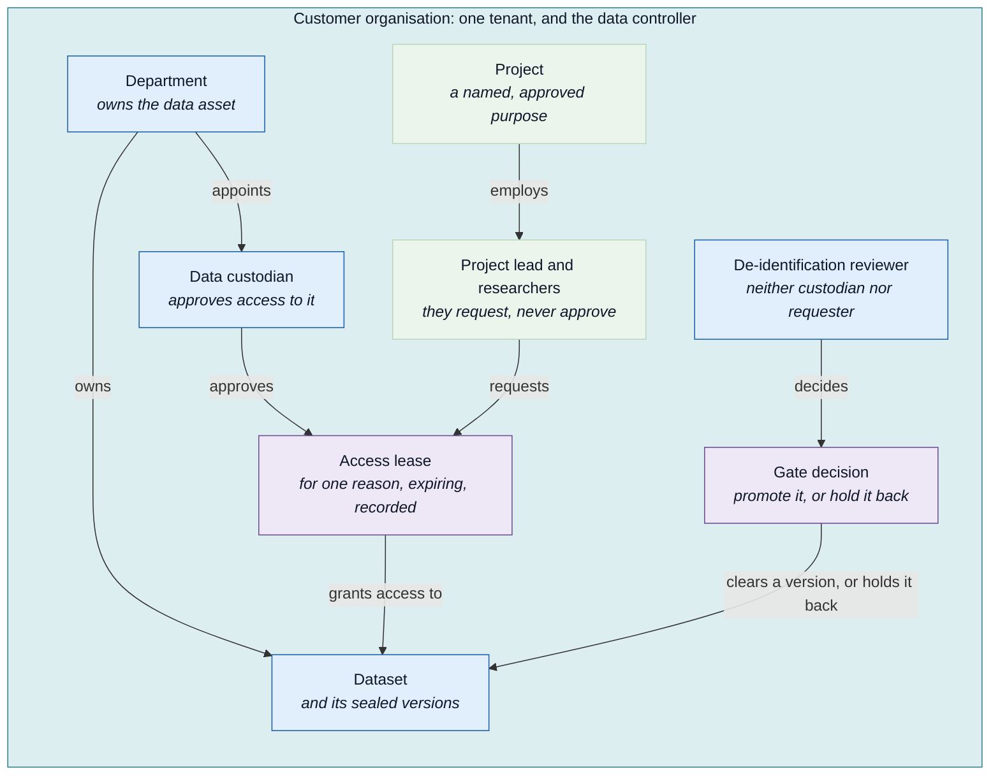

# Munitas: the governance model

Who is accountable for the data, who decides who may read it, and who may only watch.

This page is for anyone judging whether Munitas fits their organisation's rules: data protection officers, security and compliance reviewers, and the people who will own the data. It explains who decides what, and why the platform is built so that no one decides alone about their own request.

For the rules in action, see the [walkthroughs](https://albinjacob.github.io/munitas/walkthroughs/feature-walkthrough.html). For the full list of what each role can and cannot do, see the [roles reference](https://albinjacob.github.io/munitas/reference/roles.html).

---

## 1. The platform never decides

The customer organisation owns its data and decides how it is used. Munitas works on the organisation's behalf. If Munitas staff approved access to personal data, the platform would be making the customer's decisions for it.

So the platform does not decide. It makes sure the customer's decision is **clear, enforced and recorded**. The customer supplies the authority. The platform supplies the mechanism.

Two consequences follow. A platform administrator cannot approve access, because they run the system that records the approval. And Munitas support staff cannot approve anything.

---

## 2. Who owns the data

| Colour | Meaning |
| --- | --- |
| Blue | The owning side. Holds the data, or decides about it |
| Green | The requesting side. Gives a reason and asks |
| Purple | The record a decision leaves behind |
| Teal | The customer organisation |

Four words used on this page:

- A **dataset** is a named collection of records, kept as numbered **versions**. A **sealed** version is finished and can never be edited.
- A **lease** is permission to read one version for a stated reason. It ends on its own, and it is recorded.
- A **department** is the team that owns a dataset.
- A **gate decision** is whether a de-identified result may be released more widely.

**Approval always goes from the person asking to the owner of the data.** A study that uses cardiology data is approved by cardiology, even if another department runs the study. If the study approved its own access, that would be approving your own request, one step removed and harder to notice.

Some organisations use a **Data Access Committee** in place of one custodian. That fits: a department can name several approvers, and any one of them may act.

---

## 3. Who does what

Munitas has eleven roles. Most of them approve nothing.

| Role | What they do | May approve |
| --- | --- | --- |
| Data custodian | Answers for a department's data and decides who may read it | **Yes**: access to their department's data, and a role for a colleague |
| Data engineer | Brings data in, registers agents and pipelines, and starts the jobs. Does not read what the jobs produce | No |
| De-identification reviewer | Judges whether identifying details were removed well enough to release a result | **Yes**: the release of a result, but never one they started or whose pipeline they uploaded |
| Researcher | Reads published data, and can also work from a notebook and make a new dataset from it with a query | No |
| Analyst | Reads published data and has no other power | No |
| Data protection officer | Oversees how personal data is handled. Sees every decision and writes the standards a de-identified result is judged by | No |
| Privacy auditor | Checks how locked data was used, from a record with no names or values. Checks and reports, and does not set rules | No |
| AI risk owner | Decides how strictly the organisation holds its AI agents | **Yes**: the second approval on a change to an AI agent, when the organisation's rules ask for one |
| Network architect | Decides which outside addresses an agent may call | **Yes**: those addresses only |
| Platform administrator | Runs the platform itself: closes down organisations, frees storage, and places legal holds with a second administrator. Cannot read what is inside an organisation | No |
| Support and reliability | Watches that the platform is healthy, using health data only. Cannot free storage or close down an organisation | No |

Only a data custodian of the department that owns the data can approve **access**. Every other role is refused, and the platform says why.

Stopping an agent is different from approving access. The data protection officer, the AI risk owner, the platform administrator, and the custodian of the department that owns an agent can each stop it at once.

Approving access and approving a release are different questions, so they sit with different people. A custodian decides who may read a dataset. A reviewer decides whether a de-identified result is safe to release. If one person decided both, they could release their own department's output and then approve the requests to read it.

---

## 4. Decisions that need a second person

Nobody ever decides their own request.

| Decision | Who decides | Who may not |
| --- | --- | --- |
| Access to a dataset | An approver of the owning department | The person asking |
| A role for a person | A different data custodian | The person asking, and the platform administrator |
| A claim that data is less sensitive than it looks | Another approver of the owning department | The person who made the claim |
| Release of a de-identified result | A de-identification reviewer | The person who started the work, or uploaded the pipeline |
| Reading identifying values | An approver of the owning department | The person asking |
| Running an organisation's own code in a pipeline | An approver of the owning department | The person who uploaded it |
| A change that lets an AI agent do more | The owning department, and the AI risk owner when the organisation's rules ask for it | The person who submitted the new version |
| A legal hold on an organisation | Two different platform administrators | One administrator alone |

---

## 5. Department approvers

A **role** says what a person may do. A **department approver** says whose data they answer for. Hartley can approve for Cardiology and not for Oncology, even though both hold the data custodian role.

- A department can have many approvers, and any one of them may approve. One person being away never blocks a request.
- Any approver can add or remove another, with a reason that is recorded.
- Temporary cover has an end date and ends by itself.
- A department always keeps at least one permanent approver.
- The record of who answered for a department is never edited, so who was accountable on any date can always be found.

---

## 6. Roles that approve nothing, on purpose

**The data protection officer sees everything and decides nothing.** The GDPR (Article 38(6)) says a data protection officer's other tasks must not create a conflict of interest. Regulators read that to mean the officer should not also decide why and how personal data is used, because they would be checking their own decisions. In April 2020 the Belgian authority fined Proximus 50,000 euro because its officer also led audit, risk and compliance ([summary](https://www.clearygottlieb.com/news-and-insights/publication-listing/the-dilemma-of-the-part-time-dpo-lessons-learned-from-the-proximus-decision)). In Munitas the officer reads every decision, including every refusal, but approves no access.

**The platform administrator can see who read what, but cannot read it.** Power over a system and access to what is in it are different privileges. Merging them means one stolen account is a breach. In a small organisation the administrator and the custodian are sometimes the same person. The organisation may choose that, and the model keeps the two separable so the choice is visible.

**Support and reliability staff see health, never records.** If an engineer truly needs to see a record, they ask for an ordinary lease. A lease is already an emergency pass: it has a time limit, a reason, an approver and a record.

---

## 7. Why an approval can be trusted

Three things are checked every time:

1. **Authority.** The approver is a registered custodian.
2. **Relationship.** The approver answers for the department that owns the data, and is not the person asking.
3. **Identity.** The caller really is that person. Every decision needs a real sign-in and is recorded under the signed-in person's name.

Every decision is kept with its reason, who made it and when, and a record that was made is never changed. These rules are enforced by the platform itself, not left to people remembering them.
